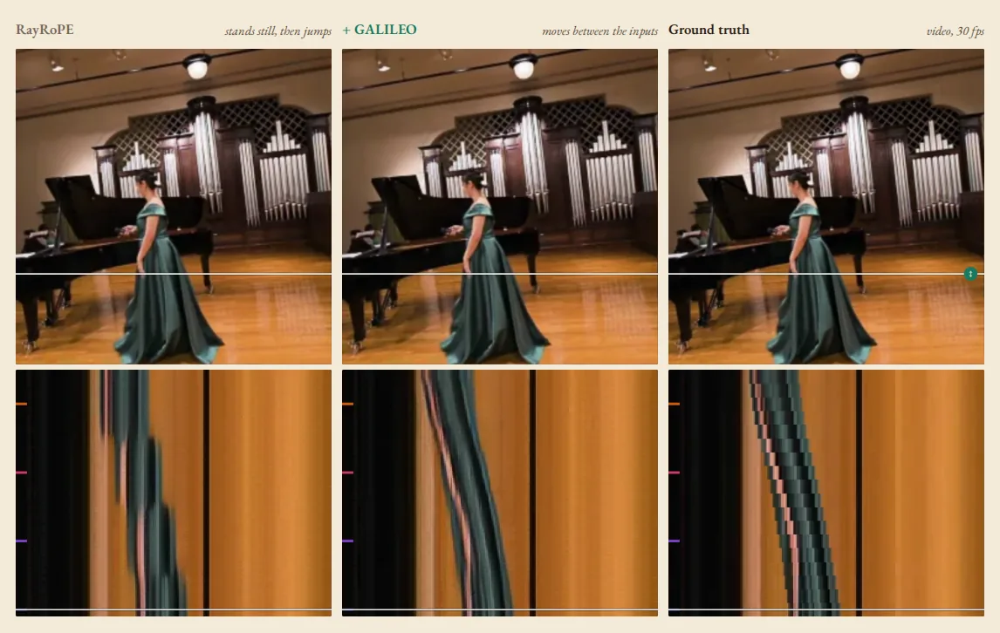

<div align="center">

<h1>GALILEO: Geometric RoPE with<br>Galilean Key Transport for Dynamic Scenes</h1>

Youngmin Kim<sup>&#42;</sup> · Seonghyun Jin<sup>&#42;</sup> · Jong Chul Ye<sup>†</sup><br>
Kim Jaechul Graduate School of Artificial Intelligence, KAIST<br>
<sub><sup>&#42;</sup>Equal contribution · <sup>†</sup>Corresponding author</sub>


<a href="https://bispl-wm.github.io/GALILEO/"></a>
<a href="#checkpoints"></a>
<a href="LICENSE"></a>



<sub>A Stereo4D test clip at 0.3× speed. Top: the only inputs, two stereo cameras at four times. Middle: the
rendering at the query time, which runs over every frame between and after the inputs; bottom: the white image row
stacked over time (time runs up, ticks in the colors of the input times). RayRoPE stands still, then jumps: a
staircase. GALILEO moves between the inputs along the slanted line of the ground truth.</sub>

</div>

GALILEO makes geometric positional encodings (RayRoPE, URoPE) work for dynamic scenes: every input token gets a
constant 3D velocity from in-model correspondences, and each key is moved to the query's time before its 3D
positional encoding is applied. This repository contains the code, configs and checkpoints of the **Stereo4D**
experiments of the paper (novel-time view synthesis from two stereo cameras at four times), including all baselines.

## Installation

```bash
git clone https://github.com/BISPL-WM/GALILEO-code.git galileo && cd galileo
pip install -r requirements.txt
```

## Data (Stereo4D)

The scripts download the public videos and annotations and rebuild the processed data used in the paper; no
derived data is redistributed. Clip lists: `splits/stereo4d/train_clips.json` (15,000 training clips),
`test_clips.json` (600 test clips) and `test_index.json` (the 1,200 test entries, interpolation and extrapolation).

```bash
export STEREO4D_RAW=/path/to/stereo4d_raw STEREO4D_DIR=/path/to/stereo4d_proc
cd scripts/prepare_stereo4d
for s in train test; do
  # 1. rectified 512x512 videos (Hugging Face, ~10 GB per eye for test, ~100 GB per eye for train)
  python download_videos.py --raw $STEREO4D_RAW --split $s --clips ../../splits/stereo4d/${s}_clips.json
  # 2. camera annotations (gs://stereo4d, camera members only)
  python fetch_cameras.py --raw $STEREO4D_RAW --split $s --clips ../../splits/stereo4d/${s}_clips.json
  # 3. one 30-frame window per clip at 256x256 with metric stereo depth (RAFT, GPU)
  python preprocess.py --raw $STEREO4D_RAW --proc $STEREO4D_DIR --split $s --clips ../../splits/stereo4d/${s}_clips.json
  # 4. ARROW tracks between the input times (in an environment with ARROW, github.com/ifradlin/arrow)
  python arrow_tracks.py --raw $STEREO4D_RAW --proc $STEREO4D_DIR --split $s
  # 5. RAFT token tracks (only for the "RAFT flow" variant)
  python raft_tracks.py --raw $STEREO4D_RAW --proc $STEREO4D_DIR --split $s
done
# 6. moving-pixel masks of the test clips (the dynamic region of PSNR_dyn)
python eval_masks.py --proc $STEREO4D_DIR --split test
```

Every script skips clips that are already done and can be sharded (`--shard i --n_shards n`).

## Checkpoints

All models: 6-layer decoder-only LVSM (12 layers where noted), 256x256, 20k steps, batch 12.
Image metrics (`evaluate.py`): mean of interpolation and extrapolation; video metrics (`evaluate_video.py`): tOF,
δ_avg and JEDi over the 1,200 test videos (paper Tab. 1 and 2; the RAFT and 12-layer rows are not in the paper's
video tables).

| Config (`configs/stereo4d/`) | Paper | PSNR_dyn | PSNR | tOF | δ_avg | JEDi |
|---|---|---|---|---|---|---|
| `plucker.yaml` | Plücker | 23.59 | 29.17 | 1.52 | .918 | 1.047 |
| `prope.yaml` | PRoPE | 24.06 | 29.95 | 1.44 | .926 | 0.741 |
| `gta.yaml` | GTA | 24.15 | 30.07 | 1.41 | .928 | 0.726 |
| `urope.yaml` | URoPE | 24.61 | 30.73 | 1.08 | .939 | 0.493 |
| `urope_galileo.yaml` | URoPE + GALILEO | 25.41 | 31.00 | 0.89 | .950 | 0.391 |
| `rayrope.yaml` | RayRoPE | 24.61 | 31.04 | 1.04 | .947 | 0.466 |
| `rayrope_galileo.yaml` | RayRoPE + GALILEO | **25.78** | 31.34 | 0.80 | .958 | **0.343** |
| `rayrope_galileo.yaml` + `--motion_off` | motion off at test (Tab. 2) | 24.47 | 30.95 | 1.09 | .947 | 0.514 |
| `rayrope_galileo_raft.yaml` | + GALILEO, RAFT flow (supp.) | 25.60 | 31.43 | 0.75 | .963 | 0.363 |
| `rayrope_L12.yaml` | RayRoPE, 12 layers (supp.) | 25.56 | 32.14 | – | – | – |
| `rayrope_galileo_L12.yaml` | RayRoPE + GALILEO, 12 layers (supp.) | 26.39 | 32.26 | 0.74 | .960 | 0.374 |

Download: (link coming soon) into `checkpoints/<config name>.safetensors`.

## Evaluation

```bash
python evaluate.py --config configs/stereo4d/rayrope_galileo.yaml --ckpt checkpoints/rayrope_galileo.safetensors \
    data_dir=$STEREO4D_DIR output_dir=runs/eval/rayrope_galileo
```

Prints the metrics per protocol and their mean; writes `tests/metrics_*.json` and per-entry values
(`tests/per_entry_*.json`). Multi-GPU: `torchrun --standalone --nproc-per-node=<n> evaluate.py ...`.

### Video metrics

One video per test clip and camera: the clip's inputs and that camera at every frame of its window (18 frames,
interpolation and one extrapolation step), rendered in one forward pass. tOF compares RAFT flows of the rendered and
ground-truth videos on the moving pixels, δ_avg tracks moving ground-truth points on the rendered video with
CoTracker3, and JEDi compares V-JEPA features of the rendered and ground-truth videos (`galileo/video_metrics.py`).

```bash
pip install --no-deps vjepa==0.1.2   # V-JEPA model code only (its pinned dependencies are not needed)
wget -P vjepa https://dl.fbaipublicfiles.com/jepa/vith16/vith16.pth.tar \
              https://dl.fbaipublicfiles.com/jepa/vith16/ssv2-probe.pth.tar
git clone https://github.com/facebookresearch/co-tracker && git -C co-tracker checkout 82e02e8
python evaluate_video.py --config configs/stereo4d/rayrope_galileo.yaml \
    --ckpt checkpoints/rayrope_galileo.safetensors --vjepa_dir vjepa --cotracker co-tracker \
    data_dir=$STEREO4D_DIR output_dir=runs/eval/rayrope_galileo
```

Writes per-video values to `runs/eval/rayrope_galileo/videos/` and prints tOF, δ_avg and JEDi once all 1,200 videos
are done. A rerun resumes; `--shard k/K` splits the videos between processes (e.g. one per GPU, then run once more
without `--shard` for the summary). The videos are rendered without `torch.compile`, as for the paper.

## Training

```bash
torchrun --standalone --nproc-per-node=1 train.py --config configs/stereo4d/rayrope_galileo.yaml \
    data_dir=$STEREO4D_DIR output_dir=runs/rayrope_galileo
```

Any config field can be overridden with `key.sub=value` (see `galileo/trainer.py: TrainConfig` and
`galileo/models/lvsm.py: ModelConfig, GalileoConfig`). `tools/export_checkpoint.py` strips a training checkpoint to
its weights.

## Code map

- `galileo/motion.py`: GALILEO itself: matching (coarse window + fine CNN stage), velocity fit, key displacement.
- `galileo/pos_enc/rayrope.py`: RayRoPE with temporal RoPE; `_motion_from_corr` / `_dynamic_kv_coeffs` apply GALILEO.
- `galileo/pos_enc/urope.py`, `prope.py`: URoPE (+ GALILEO), PRoPE / GTA.
- `galileo/models/lvsm.py`: the LVSM model and its configs; `galileo/trainer.py`: losses, training, evaluation.
- `galileo/data/stereo4d.py`: Stereo4D samples, ARROW pseudo-ground-truth motion.
- `galileo/video_metrics.py`: tOF, δ_avg and JEDi.

## Citation

```bibtex
@article{kim2026galileo,
  title   = {GALILEO: Geometric RoPE with Galilean Key Transport for Dynamic Scenes},
  author  = {Kim, Youngmin and Jin, Seonghyun and Ye, Jong Chul},
  journal = {arXiv preprint},
  year    = {2026}
}
```

## License

MIT (see `LICENSE`). Parts are adapted from RayRoPE, PRoPE and URoPE; see `THIRD_PARTY_NOTICES.md`.
